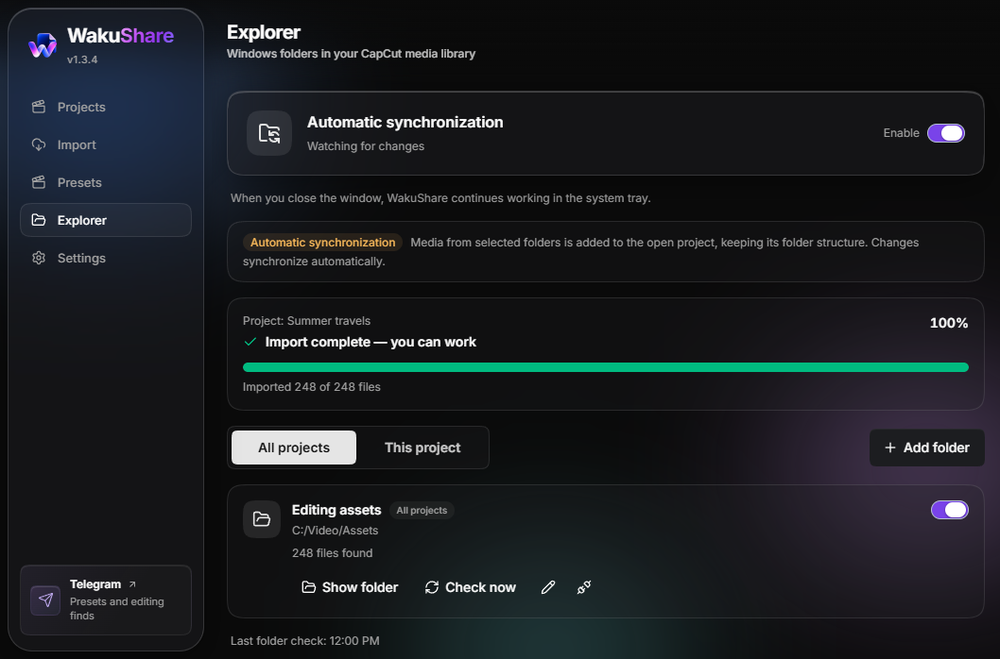
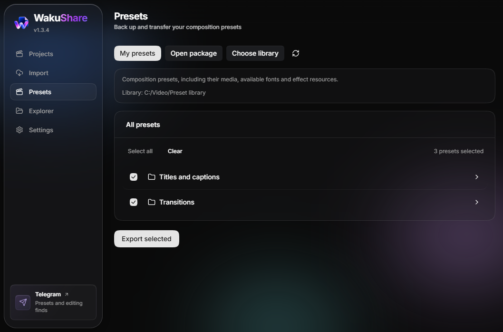

<p align="center"><a href="README.md">Русский</a> / <strong>English</strong></p>

<p align="center">
  
</p>

<h1 align="center">WakuShare</h1>

<p align="center">
  <strong>Your CapCut projects, presets, and media folders - within reach.</strong><br>
  Move edits between computers, keep your presets, and sync your folders.
</p>

<p align="center">
  <a href="https://github.com/WAKUDOdani/WakuShare/releases/download/v1.3.4/WakuShare-1.3.4-setup-x64.exe"></a>
  <a href="https://github.com/WAKUDOdani/WakuShare/releases/download/v1.3.4/WakuShare-1.3.4-portable-x64.exe"></a>
</p>

<p align="center">
  <a href="https://github.com/WAKUDOdani/WakuShare/releases/latest"></a>
  <a href="https://github.com/WAKUDOdani/WakuShare/actions/workflows/ci.yml"></a>
  <a href="LICENSE"></a>
</p>

<p align="center">
  <a href="#features">Features</a> ·
  <a href="docs/USAGE.en.md">User guide</a> ·
  <a href="https://github.com/WAKUDOdani/WakuShare/releases">What's new</a> ·
  <a href="https://t.me/WAKUDOdani">Telegram</a> ·
  <a href="https://github.com/WAKUDOdani/WakuShare/issues">Help and issues</a>
</p>

<p align="center">
  
  <br><sub>The actual WakuShare 1.3.4 interface. Screenshots use demo data.</sub>
</p>

## Features

| Task                        | What WakuShare does                                                                                                                                                                          |
| --------------------------- | -------------------------------------------------------------------------------------------------------------------------------------------------------------------------------------------- |
| **Move a project**          | Bundles your edit, available source files, and effect resources into one `.wakushare` file. Preserves multiple timelines and nested compositions. Also imports older `.capshare` packages.   |
| **Share presets**           | Exports and imports composition presets in `.wakupresets` packages, individually or with folders. Lets you review duplicates and choose a separate copy, skip, or replacement with a backup. |
| **Keep media within reach** | Explorer adds Windows folders to the CapCut media library while preserving their structure. Connect folders for all projects or just one; new files and changes are handled through events.  |

Bulk import sends new files as a single list, and the progress bar shows confirmed results. Processing speed depends on the number of files, your disk, and CapCut itself.

<details>
<summary><strong>Take a look at Presets</strong></summary>



Open a shared package, choose what you need, and import it into your library. Source files and available font files travel with the presets.

</details>

## Download

**Windows x64.** Tested editor version: **CapCut International 9.6.0.4097**. WakuShare is available in English and Russian.

| Edition                                                                                                                 | Best for                       | Updates                                                                       |
| ----------------------------------------------------------------------------------------------------------------------- | ------------------------------ | ----------------------------------------------------------------------------- |
| [**Installer 1.3.4**](https://github.com/WAKUDOdani/WakuShare/releases/download/v1.3.4/WakuShare-1.3.4-setup-x64.exe)   | A regular Windows installation | The app checks for updates; you choose when to install the downloaded release |
| [**Portable 1.3.4**](https://github.com/WAKUDOdani/WakuShare/releases/download/v1.3.4/WakuShare-1.3.4-portable-x64.exe) | Running without installation   | Download the new Portable release and replace the old EXE                     |

[All releases and checksums](https://github.com/WAKUDOdani/WakuShare/releases). You only need one EXE. There is no need to download `latest.yml`, `.blockmap`, or the runtime archive manually. `Source code` contains the source, not a ready-to-run app. Each release includes an expandable **English release notes** section at the top.

> [!NOTE]
> Builds do not yet have a Windows publisher signature. Download WakuShare from this repository and, if needed, check the file against the release's `SHA256SUMS.txt`.

## Quick start

1. Download the installer or Portable edition and open WakuShare.
2. Choose **Projects** to export an edit, **Import** to open a shared project, or **Presets** to manage your library.
3. For automatic sync, open **Explorer**, enable it, and add a folder under **All projects** or **This project**. Open the desired CapCut project and wait for import to finish.

[Step-by-step instructions, updates, and FAQs →](docs/USAGE.en.md)

## Before you start

- Exporting a project leaves its original files in place. You can import the package as a separate copy.
- Explorer works with an open CapCut project. When sync is enabled, closing the WakuShare window keeps the app running in the system tray.
- Windows may lock files used on the timeline. Leave the CapCut project before renaming or moving those files.
- Close CapCut before importing presets. System fonts are not installed automatically; cloud effects may need to be downloaded again.
- Other CapCut versions require separate testing. Encrypted JianYing projects are not supported.

## Package safety

WakuShare checks paths, sizes, structure, and resource integrity, and blocks executables and dangerous system scripts. Active effect resources require a separate trust confirmation. Confirming allows effect code to be transferred to CapCut; it does not make someone else's effect safe.

[Checks and remaining limitations](docs/security-audit-2026-10-21.md) (audit report in Russian).

## Stay in touch

[WAKUDO Dani on Telegram](https://t.me/WAKUDOdani) shares presets, WakuShare updates, and editing finds. Report bugs and suggest improvements in [Issues](https://github.com/WAKUDOdani/WakuShare/issues).

<details>
<summary><strong>For developers: build and documentation</strong></summary>

Requires Node.js 24 and pnpm 10.19.0.

```sh
pnpm install --frozen-lockfile
pnpm test --testTimeout=15000
pnpm run typecheck
pnpm run lint
pnpm dev
pnpm run build:win
```

The Windows build includes the pinned sync worker and runtimes. `runtime-lock.json` verifies the base archive; `runtime-security-lock.json` pins the refreshed Python/.NET runtimes. Downloads and verification happen during the build. Set `WAKUSHARE_RUNTIME_DIR` to use a local copy of the base runtime offline.

- [Documentation index](docs/README.md) (Russian)
- [Sync worker](docs/EXPLORER_WORKER.md) and its [source](runtime-src/README.md)
- [Preset transfer](docs/PRESET_TRANSFER.md)
- [Changelog](CHANGELOG.md) and [release process](docs/RELEASING.md) (Russian)

Tests use temporary synthetic data. Live integration checks require separate authorization and are not run by regular CI.

</details>

## Credits and license

WakuShare is developed by **WAKUDO Dani**. It is based on [CapShare](https://github.com/ilyassesalama/CapShare) by **Ilyasse Salama**, version 1.0.2. The upstream history and MIT license are preserved.

[MIT License](LICENSE) · [Third-party components](THIRD_PARTY_NOTICES.md) · [Project origins](UPSTREAM.md)
