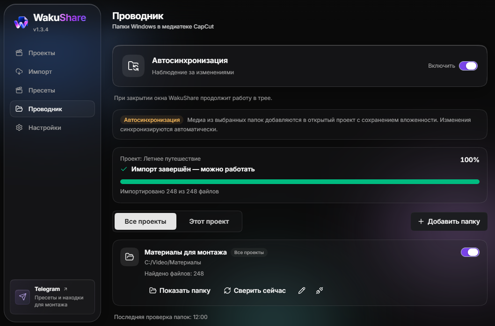
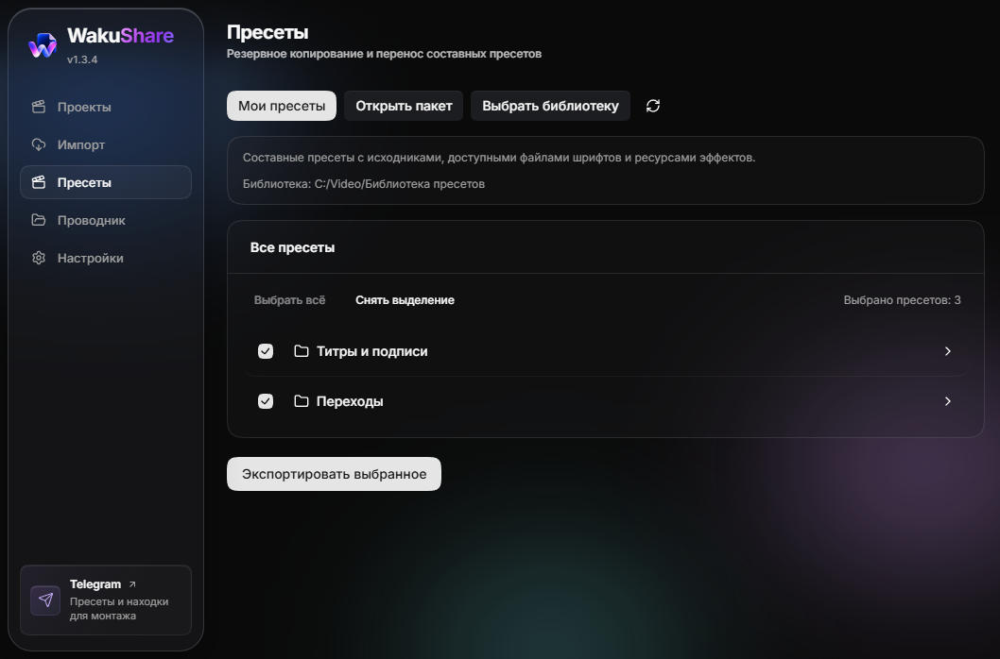

<p align="center"><strong>Русский</strong> / <a href="README.en.md">English</a></p>

<p align="center">
  
</p>

<h1 align="center">WakuShare</h1>

<p align="center">
  <strong>Проекты, пресеты и медиапапки CapCut - под рукой.</strong><br>
  Переноси монтаж между компьютерами, сохраняй пресеты и синхронизируй свои папки.
</p>

<p align="center">
  <a href="https://github.com/WAKUDOdani/WakuShare/releases/download/v1.3.4/WakuShare-1.3.4-setup-x64.exe"></a>
  <a href="https://github.com/WAKUDOdani/WakuShare/releases/download/v1.3.4/WakuShare-1.3.4-portable-x64.exe"></a>
</p>

<p align="center">
  <a href="https://github.com/WAKUDOdani/WakuShare/releases/latest"></a>
  <a href="https://github.com/WAKUDOdani/WakuShare/actions/workflows/ci.yml"></a>
  <a href="LICENSE"></a>
</p>

<p align="center">
  <a href="#возможности">Возможности</a> ·
  <a href="docs/USAGE.md">Инструкция</a> ·
  <a href="https://github.com/WAKUDOdani/WakuShare/releases">Что нового</a> ·
  <a href="https://t.me/WAKUDOdani">Telegram</a> ·
  <a href="https://github.com/WAKUDOdani/WakuShare/issues">Помощь и ошибки</a>
</p>

<p align="center">
  
  <br><sub>Настоящий интерфейс WakuShare 1.3.4. На иллюстрациях используются демонстрационные данные.</sub>
</p>

## Возможности

| Задача                      | Что делает WakuShare                                                                                                                                                                                       |
| --------------------------- | ---------------------------------------------------------------------------------------------------------------------------------------------------------------------------------------------------------- |
| **Перенести проект**        | Собирает монтаж, доступные исходники и ресурсы эффектов в один `.wakushare`. Сохраняет несколько временных шкал и вложенные композиции. Импортирует и прежние `.capshare`.                                 |
| **Поделиться пресетами**    | Экспортирует и импортирует композиционные пресеты в `.wakupresets`: по отдельности или вместе с папками. Позволяет проверить дубликаты и выбрать копирование, пропуск или замену с резервной копией.       |
| **Держать медиа под рукой** | Раздел «Проводник» добавляет папки Windows в медиатеку CapCut с сохранением вложенности. Подключения доступны для всех проектов или только выбранного; новые файлы и изменения обрабатываются по событиям. |

Пакетный импорт передаёт новые файлы одним списком, а шкала показывает подтверждённый прогресс. Скорость обработки зависит от количества файлов, диска и самого CapCut.

<details>
<summary><strong>Посмотреть раздел «Пресеты»</strong></summary>



Можно открыть чужой пакет, выбрать нужное и импортировать в свою библиотеку. Исходники и доступные файлы шрифтов переносятся вместе с пресетами.

</details>

## Скачать

**Windows x64.** Проверенная версия редактора: **CapCut International 9.6.0.4097**. Интерфейс WakuShare доступен на русском и английском.

| Вариант                                                                                                                 | Для кого                               | Обновления                                                                   |
| ----------------------------------------------------------------------------------------------------------------------- | -------------------------------------- | ---------------------------------------------------------------------------- |
| [**Установщик 1.3.4**](https://github.com/WAKUDOdani/WakuShare/releases/download/v1.3.4/WakuShare-1.3.4-setup-x64.exe)  | Обычная установка приложения в Windows | Приложение проверяет обновления; установку скачанного выпуска запускаешь сам |
| [**Portable 1.3.4**](https://github.com/WAKUDOdani/WakuShare/releases/download/v1.3.4/WakuShare-1.3.4-portable-x64.exe) | Запуск без установки                   | Скачать новую Portable-версию и заменить старый EXE                          |

[Все выпуски и контрольные суммы](https://github.com/WAKUDOdani/WakuShare/releases). Для работы нужен один EXE. `latest.yml`, `.blockmap` и runtime-архив скачивать вручную не требуется. `Source code` содержит исходники, а не готовое приложение.

> [!NOTE]
> Сборки пока без цифровой подписи издателя Windows. Скачивай WakuShare из этого репозитория и при необходимости сверяй файл с `SHA256SUMS.txt` в релизе.

## Быстрый старт

1. Скачай установщик или Portable и открой WakuShare.
2. Выбери задачу: **«Проекты»** для экспорта, **«Импорт»** для полученного проекта, **«Пресеты»** для библиотеки.
3. Для автосинхронизации открой **«Проводник»**, включи её и добавь папку в область **«Все проекты»** или **«Этот проект»**. Открой нужный проект CapCut и дождись завершения импорта.

[Пошаговая инструкция, обновления и ответы на вопросы →](docs/USAGE.md)

## Что стоит знать

- Исходные файлы при переносе проекта не перемещаются. Полученный пакет можно импортировать отдельной копией.
- «Проводник» работает с открытым проектом CapCut. При включённой синхронизации закрытие окна WakuShare оставляет приложение работать в трее.
- Windows может удерживать файлы, которые используются на таймлайне. Для их переименования или переноса сначала выйди из проекта в CapCut.
- Пресеты импортируются при закрытом CapCut. Системные шрифты автоматически не устанавливаются; облачные эффекты могут потребовать повторного скачивания.
- Другие версии CapCut требуют отдельной проверки. Зашифрованные проекты JianYing не поддерживаются.

## Безопасность пакетов

WakuShare проверяет пути, размеры, структуру и целостность ресурсов, блокирует исполняемые файлы и опасные системные сценарии. Активные ресурсы эффектов требуют отдельного подтверждения доверия. Подтверждение разрешает перенос кода в CapCut, но не делает чужой эффект безопасным.

[Что проверяет приложение и где остаются ограничения](docs/security-audit-2026-10-21.md).

## На связи

В [Telegram WAKUDO Dani](https://t.me/WAKUDOdani) - пресеты, обновления WakuShare и находки для монтажа. Об ошибках и предложениях можно написать в [Issues](https://github.com/WAKUDOdani/WakuShare/issues).

<details>
<summary><strong>Разработчикам: сборка и документация</strong></summary>

Нужны Node.js 24 и pnpm 10.19.0.

```sh
pnpm install --frozen-lockfile
pnpm test --testTimeout=15000
pnpm run typecheck
pnpm run lint
pnpm dev
pnpm run build:win
```

Windows-сборка включает закреплённые модуль синхронизации и среды запуска. `runtime-lock.json` проверяет базовый архив; `runtime-security-lock.json` фиксирует обновлённые Python/.NET. Загрузка и проверка выполняются при сборке. Для автономного использования базового runtime можно задать `WAKUSHARE_RUNTIME_DIR`.

- [Навигация по документации](docs/README.md)
- [Модуль синхронизации](docs/EXPLORER_WORKER.md) и его [исходники](runtime-src/README.md)
- [Перенос пресетов](docs/PRESET_TRANSFER.md)
- [История изменений](CHANGELOG.md) и [порядок выпуска](docs/RELEASING.md)

Тесты используют временные синтетические данные. Живые интеграционные проверки требуют отдельного согласования; обычный CI их не запускает.

</details>

## Авторство и лицензия

WakuShare развивает **WAKUDO Dani**. Основа - [CapShare](https://github.com/ilyassesalama/CapShare) от **Ilyasse Salama**, версия 1.0.2. Сохранены история upstream и MIT-лицензия.

[MIT License](LICENSE) · [Сторонние компоненты](THIRD_PARTY_NOTICES.md) · [История происхождения](UPSTREAM.md)
